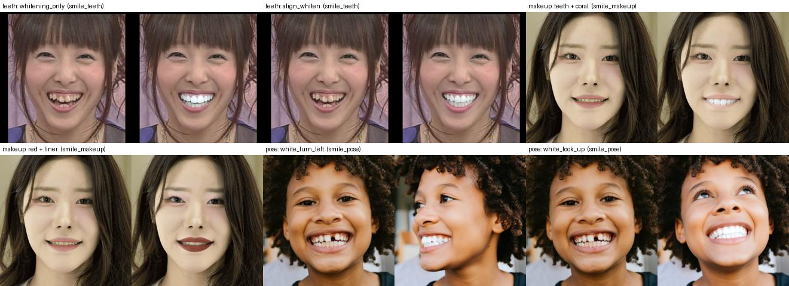

# Smile Design 튜닝 서버 / 클라이언트 가이드

FLUX.2 Klein 4B 기반 Smile Design 튜닝 서버(`my/design_tune_server.py`)와
테스트용 CLI 클라이언트(`my/design_tune_client.py`)의 실행 방법, API, 얼굴 마스크 옵션을 정리한다.

- 서버: 스타일 YAML 관리, 프롬프트 임베딩 빌드, 이미지 추론
- 클라이언트: 서버 API를 터미널에서 호출 (빌드 → 폴더 순차 추론까지 한 번에 가능)
- 데스크톱 앱용 클라이언트 함수는 `my/temp/flux2_backend.py`에 있다 (마스크 옵션은 아직 미지원).
- 스타일 / 프롬프트 / pose / 메이크업 실험 결과와 다음 실험 계획은 [experiments.md](experiments.md)에 있다.
- 기본 스타일 3개의 preset별 결과 이미지와 수치는 [experiments_preset.md](experiments_preset.md)에 있다.

## 1. 구성 파일

| 파일 | 역할 |
| --- | --- |
| `my/design_tune_server.py` | Flask 서버. 스타일 CRUD, 임베딩 빌드 job, 추론, 마스크 미리보기 |
| `my/smile_design/face_mask.py` | MediaPipe Face Landmarker로 입술/치아/눈가/볼/얼굴 영역 마스크 생성 |
| `my/smile_design/mice.py` | MICE 영역별 지시문 attention bias (5.2장) |
| `my/design_tune_client.py` | 테스트용 CLI 클라이언트 (`health`, `styles`, `build`, `mask`, `infer`, `run`) |
| `my/configs/smile_design/*.yaml` | 스타일 정의 (프롬프트 템플릿, layout, control, preset, grid) |
| `my/build_smile_embedding_library.py` | 임베딩 빌더. 서버가 build 요청 시 별도 프로세스로 실행 |
| `weights/face_landmarker.task` | MediaPipe 얼굴 랜드마크 모델 (3.7MB, Apache 2.0) |

## 2. 환경 설정

`diffuser_lora` conda 환경 기준.

```bash
# MediaPipe (numpy / protobuf 버전은 바뀌지 않음)
pip install mediapipe==1.1.0

# MediaPipe 1.1은 CPU로만 돌려도 EGL / GLES 라이브러리가 필요하다
apt-get install -y libegl1 libgles2

# 얼굴 랜드마크 모델
curl -L -o weights/face_landmarker.task \
  https://storage.googleapis.com/mediapipe-models/face_landmarker/face_landmarker/float16/latest/face_landmarker.task
```

주의: `mediapipe`가 `opencv-contrib-python`을 함께 설치한다. 기존 `opencv-python`과 같은 `cv2` 폴더를 쓰므로
두 패키지의 버전을 같게 유지한다 (한쪽만 업그레이드/삭제하면 `cv2`가 깨질 수 있다).

## 3. 서버 실행

```bash
python my/design_tune_server.py --port 5000 --device cuda:0
```

주요 옵션:

| 옵션 | 기본값 | 설명 |
| --- | --- | --- |
| `--port` | `5000` | 데스크톱 앱 기본 주소(`http://10.100.1.45:8603`)에 맞추려면 `8603` |
| `--device` | `cuda:0` | 추론에 쓸 GPU (빌드도 기본은 같은 GPU) |
| `--styles-dir` | `my/configs/smile_design` | 스타일 YAML 폴더 |
| `--libraries-dir` | `outputs/design_tune_embedding_libraries` | 임베딩 라이브러리 저장 위치 |
| `--steps` / `--guidance-scale` | `4` / `1.0` | 요청에서 `num_steps`, `guidance_scale`로 덮어쓸 수 있음 |
| `--mask` / `--no-mask` | off | 얼굴 마스크 합성 기본값 (요청별로 덮어쓸 수 있음) |
| `--mask-mode` | `inpaint` | 기본 `mask.mode` (`inpaint`/`composite`/`mice`, 5장 참고). 요청별로 덮어쓸 수 있음 |
| `--mask-regions` | `mouth` | 쉼표 구분 영역 목록 (5장 참고) |
| `--mask-dilate` | `8` | 마스크 확장 (픽셀) |
| `--mask-feather` | `12.0` | 마스크 경계 blur 반경 (픽셀) |
| `--face-landmarker-model` | `weights/face_landmarker.task` | MediaPipe 모델 경로 |
| `--fp8-weights` / `--no-fp8-weights` | on | transformer 가중치를 fp8로 **저장**하고 레이어별로 bf16으로 올려 계산 (9장 참고) |
| `--min-steps-non-distilled` | `20` | 비증류 모델(`is_distilled: false`)에서 step 수가 이보다 낮으면 경고 로그 + 응답 `step_warning` (klein-base-4B를 적은 step으로 쓰면 뭉개진 결과가 나오는 문제, [final_report.md 0.1절](final_report.md#01-distilled는-스텝-설정이-아니라-완전히-다른-가중치다)) |
| `--build-device` | `--device`와 같음 | 임베딩 빌드용 GPU. 다르게 지정하면 빌드 중에도 추론 가능 (7.2장) |
| `--build-timeout` | `7200` | 임베딩 빌드 제한 시간 (초) |

## 4. REST API

| Method | Path | 용도 |
| --- | --- | --- |
| `GET` | `/health` | 서버 상태, 모델 로드 여부, 마스크 기본값 / 사용 가능한 영역 |
| `GET` | `/api/v1/styles` | 스타일 목록 (`library_ready`로 빌드 여부 확인) |
| `GET` | `/api/v1/styles/{name}` | YAML 조회 |
| `PUT` | `/api/v1/styles/{name}` | YAML 추가 / 수정 (`{"yaml": "..."}`) |
| `DELETE` | `/api/v1/styles/{name}` | 스타일 삭제 (임베딩 캐시는 남는다) |
| `POST` | `/api/v1/styles/{name}/build` | 임베딩 빌드 시작 → `job_id` 반환 |
| `GET` | `/api/v1/jobs/{job_id}` | 빌드 상태 (`queued` / `running` / `succeeded` / `failed`) |
| `POST` | `/api/v1/infer` | 추론. multipart `images`(layout role 순서) + `parameters`(JSON) |
| `POST` | `/api/v1/mask` | 생성 없이 마스크만 확인. multipart `images` + `parameters` |

추론 `parameters` 예시:

```json
{
  "style_name": "smile_v1",
  "layout": "patient_only",
  "mode": "preset",
  "preset": "strong_whitening",
  "seed": 0,
  "mask": {"regions": ["lips", "teeth"], "dilate": 8, "feather": 12}
}
```

- `mode`: `preset` / `anchor` / `grid` / `delta` (`control_values`, `grid`, `attribute`, `delta_strengths`는 모드에 맞게)
- 첫 번째 이미지는 항상 환자(`patient`) 사진이다. 출력 크기는 첫 번째 이미지 크기와 같다.
- 응답은 PNG 바이너리이고, 사용한 설정은 `X-Design-Tune-Metadata` 헤더(JSON)에 들어 있다.

## 5. 얼굴 마스크 옵션

`parameters.mask.mode`로 방식을 고른다. **서버 기본값은 `inpaint`다** (`--mask-mode`로 변경 가능,
[final_report.md 0.5절](final_report.md#05-기본값을-composite에서-inpaint로-변경--mice-다중-영역-조합을-진짜-inpaint로-재구현)
— composite는 좁은 영역의 정밀한 변화에 capacity를 충분히 못 써서 기본값에서 제외했다).

| mode | 동작 |
| --- | --- |
| `inpaint` (기본, 권장, 5.3장) | `Flux2KleinInpaintPipeline`으로 마스크 영역만 **latent 단계에서 실제로** 재생성. `edits`를 주면 영역마다 순차적인 진짜 inpaint로 조합 (MICE 대체) |
| `composite` (레거시) | 프롬프트 하나로 전체 이미지를 생성한 뒤, **선택한 영역만** 원본 환자 사진 위에 합성 (후처리) |
| `mice` (레거시) | 영역별 지시문을 attention bias로 각 영역에 묶어 한 번에 생성 (5.2장). `composite: true`면 생성 후 편집 영역만 원본에 합성 |

### 5.1 composite (레거시)

마스크 밖은 원본 픽셀이 그대로 유지된다 (테스트에서 마스크 밖 픽셀 차이 0).

요청별 지정 (`parameters.mask`):

| 값 | 동작 |
| --- | --- |
| 생략 | 서버 기본값 (`--mask`, `--mask-regions` 등) |
| `true` / `false` | 기본 영역으로 켜기 / 끄기 |
| `{"regions": [...], "dilate": n, "feather": f}` | 켜고 영역 / 크기 지정 (`"enabled": false`로 끌 수도 있음) |

영역 (여러 개 지정하면 합집합):

| 영역 | 내용 |
| --- | --- |
| `upper_lip` / `lower_lip` | 윗입술 / 아랫입술 |
| `lips` | 입술 전체 |
| `inner_mouth` | 안쪽 입술 사이 (치아 + 혀 + 구강) |
| `teeth` | `inner_mouth` 중 밝고 붉지 않은 픽셀 (LAB 밝기 Otsu 후처리) |
| `mouth` | `lips` + `inner_mouth` |
| `face` | 얼굴 윤곽 |
| `eyes` | 눈 윤곽 + 눈썹까지의 눈두덩 (아이라인 / 아이섀도용) |
| `cheeks` | 광대 랜드마크 다각형 (블러셔용. 4 step 모델에서 볼 색이 얼룩지는 문제로 현재 스타일에서는 미사용) |

동작 방식과 한계:

- MediaPipe Face Landmarker(478점)의 입술 / 얼굴 윤곽 점을 다각형으로 채운 근사 마스크다 (픽셀 단위 분할 모델이 아님).
- 얼굴이 검출되지 않으면 GPU 추론 전에 400 에러를 반환한다.
- 마스크는 **원본 사진 기준**이다. `broad_smile`, `mouth_opening`처럼 입 모양을 바꾸는 편집은
  `lips` / `teeth`만 쓰면 새 입 모양이 잘린다 → `mouth` 또는 `face`에 `dilate`를 크게 준다.
- 아주 가까운 클로즈업에서는 윗입술 다각형이 치아 끝을 살짝 덮을 수 있다.
- `teeth`는 밝기 규칙이라 누렇거나 그늘진 치아는 놓칠 수 있다.
- Face Landmarker는 CPU로 동작한다 (이미지당 약 10~30ms).

### 5.2 MICE (영역별 지시문 동시 편집, 레거시)

**여러 영역을 한 번에 조합하는 용도라면 5.3장의 `mask.mode: "inpaint"` + `edits`를 권장한다** — 결과가 더
정확하고(영역 간 번짐 없음), `text_tokens`/`kernel_size`/`temperature` 같은 attention-bias 하이퍼파라미터
튜닝이 필요 없다. MICE는 "여러 영역을 한 번의 forward로 묶어야" 하는 경우에만 쓴다.

논문 "Editing Everything Everywhere All at Once"(MICE, arXiv 2606.31278)의 방식을 논문 설명을 바탕으로 직접 구현했다
(공개 저장소는 라이선스가 없어 코드를 가져오지 않았다). diffusers 코어는 수정하지 않는다.

- 원리: transformer joint attention logits에 bias를 더한다 (`Softmax(QKᵀ/√d + B)`). 마스크를 토큰 격자(16px)로 줄여
  - 영역 n 지시문 ↔ 영역 n 이미지 토큰만 연결
  - 영역 n 이미지 토큰 → 다른 이미지 토큰: 영역 안 0, 멀어질수록 Gaussian 감쇠, 다른 영역 차단, **전역 지시문 차단**
  - 전역 지시문 ↔ 배경(마스크 밖) 이미지 토큰
- 토큰 순서: `[전역 지시문, 영역 1 지시문, ..., 생성 latent, 환자 참조 latent, 기타 참조 latent]`.
  bias는 transformer forward pre-hook에서 실제 길이 / 격자를 읽어 만들고, 요청이 끝나면 hook을 제거한다
  (**mice가 아닌 요청은 기존 속도 그대로**, 실측 4.58초 → mice 후에도 4.60초).
- 마스크는 토큰 격자로 줄인 뒤 퍼뜨려 쓰므로 **경계가 픽셀 단위로 정밀할 필요는 없다**. 다만 치아 / 입술처럼 붙은 영역은
  각 토큰이 50% 이상 덮은 영역 하나에 배정되므로 경계 위치에 따라 결과가 갈린다.
- **MICE만으로는 배경 픽셀이 보존되지 않는다** (전체 재생성 특성, 배경 차이 11~23 / 0~255). 픽셀 보존이 필요하면 `composite: true`.

YAML에 `mice` 섹션이 있어야 한다 (예: [configs/smile_v2_mice.yaml](configs/smile_v2_mice.yaml)). 빌드 시 `mice` 종류 임베딩이 함께 만들어진다.

```yaml
mice:
  global:
    default: "Edit image 1, a photo of this person. {reference_instructions} Keep exactly the same person, ..."
  regions:
    teeth_white: {region: [teeth, inner_mouth], prompt: "Make these teeth a clean natural bright white color. ..."}
    lips_red:    {region: [lips], prompt: "Apply a vivid red lipstick to these lips. ..."}
```

요청 예시:

```json
{
  "style_name": "smile_v2_mice",
  "layout": "patient_only",
  "seed": 0,
  "mask": {
    "mode": "mice",
    "edits": [{"prompt": "teeth_white"}, {"prompt": "lips_red", "region": ["lips"]}],
    "composite": true, "feather": 6, "dilate": 4
  }
}
```

| 옵션 | 기본값 | 설명 |
| --- | --- | --- |
| `edits` | (필수) | `{"prompt": 영역 지시문 이름, "region": 선택, "dilate": 선택}` 목록. `region` 생략 시 YAML 기본 영역 |
| `global` | `default` | 전역 지시문 이름 |
| `text_tokens` | 200 | 지시문당 텍스트 토큰 수 (padding 포함). `0`이면 실제 토큰만 사용 → **품질 저하** (치아 푸른빛, 색 번짐) |
| `kernel_size` / `temperature` | 11 / 3.0 | 영역 경계 Gaussian 크기 / 감쇠 세기 (temperature 1~8에서 결과 차이는 작았음) |
| `mice_steps` | 전체 | 앞 N 스텝에만 bias 적용 |
| `composite` | false | 생성 후 편집 영역(합집합, dilate + feather)만 원본에 합성 |

비용 (A6000, fp8, 약 1MP): 시간 **+35~43%** (4.0초 → 1영역 5.3초, 3영역 5.7초), 최대 VRAM **+0.3GB** (6.7 → 7.0GB).
빠른 flash 커널 대신 bias를 지원하는 커널을 쓰기 때문이다.

### 5.3 inpaint (진짜 latent 단위 마스크 편집, 권장)

`composite`는 전체 이미지를 새로 생성한 뒤 마스크 영역만 잘라 붙이는 방식이라, 모델이 좁은 영역의 정밀한
변화(치아 모양 등)에 capacity를 충분히 못 쓴다. `inpaint`는 diffusers의 `Flux2KleinInpaintPipeline`으로
**mask_image가 가리키는 영역만 latent 단계에서 실제로 재생성**한다 — 품질이 뚜렷이 낫고(특히 치아가 심하게
망가진 극단적 케이스), 속도는 composite와 비슷하거나 더 빠르다 (실측: [final_report.md 0.2절](final_report.md#02-서버-통합-완료--5명-전체-재실험)).

```json
{
  "style_name": "smile_final", "layout": "patient_tooth",
  "mode": "preset", "preset": "align_whiten",
  "mask": {"mode": "inpaint", "regions": ["mouth"], "dilate": 16, "feather": 12, "strength": 1.0}
}
```

- `regions`/`dilate`/`feather`는 `composite`와 같은 의미로 mask_image를 만든다.
- `strength`(기본 1.0): 1.0이면 마스크 안을 완전히 새로 생성, 낮추면 원본과 부분적으로 섞인다.
- **layout에 두 번째 이미지가 있으면(예: `patient_tooth`) 자동으로 `image_reference`(치아 템플릿 등 "무엇으로
  채울지"의 참조 이미지)로 전달된다** — 별도 파라미터가 필요 없다. `patient_only`(이미지 1장)로는 템플릿을
  넣을 수 없다 (reference_roles가 이미지 수를 그대로 강제한다).
- `prompt_embeds`는 `mode: preset/anchor/grid/delta`로 만든 **기존 캐시 임베딩을 그대로 쓴다** — 재빌드가
  필요 없다. `edits`가 없을 때(위 예시)는 이 방식으로 regions 전체를 한 번에 inpaint한다.
- 마스크 밖 픽셀은 생성이 끝난 뒤 한 번 더 원본과 합성해 픽셀 단위로 보존한다(resize 오차 방지).

#### 여러 영역을 한 번에 조합 (`edits`, MICE 대체)

MICE처럼 영역마다 다른 지시문(예: 치아 + 입술 + 눈)을 한 요청에서 조합하려면 `mask.edits`를 쓴다. YAML에
`mice.regions` 섹션이 있어야 하고(5.2장과 같은 스키마), 영역 지시문 캐시 임베딩이 빌드돼 있어야 한다.

```json
{
  "style_name": "pose-makeup-v2",
  "layout": "patient_only",
  "seed": 0,
  "mask": {
    "mode": "inpaint",
    "feather": 6, "dilate": 4,
    "edits": [{"prompt": "teeth_white"}, {"prompt": "lips_red"}, {"prompt": "eyes_liner"}]
  }
}
```

- MICE의 attention bias 대신, **영역마다 순차적으로 진짜 inpaint 호출을 체이닝**한다(`InferenceEngine._inpaint_sequential`):
  각 호출은 그 영역의 캐시 임베딩만 쓰고, 이전 호출의 출력 위에 다음 영역을 이어서 inpaint한다. 끝나면 전체
  영역 합집합 마스크로 원본과 한 번 더 합성한다.
- 영역이 완전히 독립적인 호출이라 MICE처럼 `text_tokens`/`kernel_size`/`temperature`를 맞출 필요가 없고,
  영역 간 번짐도 구조적으로 생기지 않는다.
- 속도는 영역 수에 비례한다(영역당 약 1회 inpaint 호출 분, [final_report.md 0.5절](final_report.md#05-기본값을-composite에서-inpaint로-변경--mice-다중-영역-조합을-진짜-inpaint로-재구현)
  실측: 3영역 체이닝 13.7초, 영역당 약 4.6초).
- 응답 메타데이터: `mix.mode: "inpaint_sequential"`, `mask.sequential_edits`에 영역별 마스크 픽셀 수 등이 기록된다.

## 6. 클라이언트 (`my/design_tune_client.py`)

서버 주소는 `--server` 또는 환경변수 `DIFFUSION_TUNE_SERVER_URL` (기본 `http://127.0.0.1:5000`).

```bash
C="python my/design_tune_client.py --server http://127.0.0.1:5000"

$C health                                   # 서버 상태
$C styles                                   # 스타일 목록 / 빌드 여부
$C build smile_v1 --layout patient_only --wait   # 빌드 요청 후 완료까지 대기

# 마스크만 확인 (overlay: 원본 위에 빨간색으로 표시)
$C mask patient.png --regions lips,teeth --overlay -o mask.png

# 단일 추론
$C infer smile_v1 patient.png --preset strong_whitening --mask lips,teeth -o out.png
$C infer smile_v1 patient.png --mode grid --grid whitening_smile \
   --controls '{"whitening": 70, "smile_intensity": 50}' --no-mask -o out.png

# 빌드 → 완료 대기 → 폴더 이미지를 순서대로 추론 (이미지마다 프리셋 전부)
$C run smile_v1 <입력폴더> <출력폴더> \
   --build --layout patient_only --preset natural,strong_whitening --mask lips,teeth
```

`run` 결과:

- `<출력폴더>/<이미지이름>__<프리셋>.png`
- `<출력폴더>/results.json`: 이미지별 상태, 소요 시간, 메타데이터 (실패 시 에러 메시지)
- 한 장이 실패해도 (예: 얼굴 미검출) 나머지는 계속 처리한다.
- `patient_tooth` 등 참조 이미지가 필요한 layout은 `--reference`로 layout 순서대로 추가한다.

## 7. 튜닝 흐름

1. 스타일 YAML 수정 → `PUT /api/v1/styles/{name}`
2. `POST /api/v1/styles/{name}/build` → `GET /api/v1/jobs/{job_id}`로 완료 확인
3. `POST /api/v1/infer`로 결과 확인 (마스크 영역은 `POST /api/v1/mask`로 먼저 확인)

서버 재시작은 필요 없다.

### 7.1 스타일과 임베딩 라이브러리 일치

- 라이브러리 경로는 `<libraries-dir>/<YAML 파일 이름>/<YAML 내용 SHA256>`이다.
  - 요청에 `smile_v1`, `smile-v1`(template_version) 중 무엇을 써도 같은 YAML로 해석되어 같은 경로를 쓴다
    (이전에는 요청 이름이 경로에 그대로 들어가 표기가 다르면 409가 났다 → 수정됨).
  - SHA256은 YAML을 파싱한 내용 기준이라 **주석 / 공백 변경은 재빌드가 필요 없다.**
  - 프롬프트, control, preset, layout, mice 영역 중 하나라도 바뀌면 새 경로가 되어 **재빌드가 필요하다.**
- 빌드 여부 확인: `GET /api/v1/styles`의 `library_ready` (클라이언트 `styles` 명령의 `ready=True/False`).
  현재 YAML 내용의 해시 경로에 manifest가 있는지로 판단한다.
- 중복 빌드 방지 (`POST /api/v1/styles/{name}/build`):
  - 현재 YAML 내용으로 이미 다 빌드되어 있으면 빌드 프로세스를 띄우지 않고 **200 + `"skipped": true`**로 바로 응답한다.
  - 같은 라이브러리를 빌드 중이면 새 작업 대신 **진행 중인 작업**을 돌려준다 (동시 3회 요청 → 작업 1개, 빌드 프로세스 1개 확인).
  - 강제로 다시 빌드하려면 `{"overwrite": true}` (클라이언트 `--overwrite`).
- 재빌드 전에는 해당 스타일 추론이 409 (`Embedding library is not built`, 응답에 `build_endpoint` 포함)를 반환한다.
  이전 라이브러리를 자동으로 쓰지 않으므로 "YAML은 바뀌었는데 예전 임베딩으로 추론"되는 불일치는 생기지 않는다.
- 빌드가 끝나면 다음 요청부터 바로 새 임베딩이 쓰인다 (서버 재시작 불필요, 요청마다 라이브러리를 새로 연다).
- 라이브러리 manifest에 서버 모델 경로가 기록되어, 다른 모델로 빌드한 라이브러리는 409로 거부한다.
- YAML을 이전 내용으로 되돌리면 이전 라이브러리를 재빌드 없이 다시 쓴다.
- 이전 해시의 라이브러리는 **자동 삭제되지 않는다** (스타일 하나 약 0.1~1.8GB). 실험이 끝나면 정리한다.
- 최종 배포에서 YAML을 고정한다면 라이브러리를 미리 빌드해 함께 배포하고, `PUT` / `build` API를 막으면 된다.

### 7.2 빌드 중 VRAM과 반환

- 빌드는 서버와 **별도 프로세스**(`my/build_smile_embedding_library.py`)에서 text encoder(Qwen3 4B)를 올려 실행한다.
  프로세스가 끝나면 그 VRAM은 **전부 반환**된다 (서버 프로세스에는 text encoder가 남지 않는다).
- 실측 (A6000, 같은 GPU): 서버만 8.9GB → 빌드 중 최대 17.3GB (+8.3GB, 프롬프트 수에 따라 10~14초) → 빌드 후 8.9GB.
- 같은 GPU에서 빌드하면 GPU 락 때문에 **빌드가 끝날 때까지 다른 추론이 대기**한다.
- `--build-device`로 빌드를 다른 GPU에서 돌리면 락을 잡지 않아 **빌드 중에도 추론이 된다** (실측: 빌드 중 추론 4.6초 정상 처리).
  빌드 서브프로세스는 서버의 `CUDA_VISIBLE_DEVICES`를 물려받으므로 두 GPU를 모두 보이게 띄운다:

```bash
CUDA_VISIBLE_DEVICES=2,3 python my/design_tune_server.py --device cuda:0 --build-device cuda:1
```

### 7.3 기본 스타일

`my/configs/smile_design/`에 실험 결과를 반영한 기본 스타일 3개가 있다. 각 YAML 상단 주석에 권장 요청이 있다.

| 파일 | 용도 | 권장 요청 | 빌드 (고유 프롬프트 / 용량) |
| --- | --- | --- | --- |
| `smile_teeth.yaml` | 치아 미백 / 교정 | `preset` (`whitening_only`, `align_snaggle`, `align_only`, `align_whiten`) + composite 마스크 (`teeth+inner_mouth` 또는 `mouth`) | 50개 / 약 0.4GB (layout 2개) |
| `smile_makeup.yaml` | 치아 + 입술 + 눈가 동시 | `mask.mode: mice`, `composite: true`, edits: `teeth_white`, `teeth_align_white`, `lips_nude_gloss` / `lips_coral` / `lips_red`, `eyes_liner` / `eyes_soft_shadow` | 13개 / 약 0.1GB |
| `smile_pose.yaml` | 치아 + 고개 방향 | `preset` (`turn_left`, `white_look_up` 등) 또는 `delta`, **마스크 off** | 30개 / 약 0.24GB |
| `smile_v1.yaml` | 초기 스타일 (실험 기준) | – | 228개 / 1.8GB |



## 8. 성능 / 용량 (RTX A6000 기준 측정값)

| 항목 | 값 |
| --- | --- |
| 빌드 (`patient_only`, 항목 57개 / 고유 프롬프트 38개) | 약 12초 (text encoder 로드 약 8초 + 인코딩 개당 0.07초) |
| 빌드 (`smile_v1` 전체, 고유 프롬프트 228개) | 약 25~30초 추정 (미측정) |
| 빌드 (`smile_v1` 전체, 6 layout, 고유 프롬프트 228개) | 26초 (실측), 1.8GB |
| 임베딩 1개 | `[1, 512, 7680]` bf16, 약 7.9MB |
| 라이브러리 (`patient_only`) | 약 293MB |
| 임베딩 로드 (preset 1개) | 약 6~9ms (요청마다 디스크에서 로드, 메모리 캐시 없음) |
| 추론 (4 step, 약 1MP) | `patient_only` 약 4.0초, 참조 이미지 1장 추가마다 약 +1~1.5초 (`patient_tooth_mouth_pose` 6.9초) |

- 서버는 Qwen text encoder를 로드하지 않는다. 임베딩을 미리 빌드해 두는 이유가 이것이다 (text encoder bf16 약 8.1GB 절약).
- 참조 이미지(치아 / 입 / 포즈)는 요청마다 VAE로 인코딩된다 (latent를 미리 저장하지 않음). 참조 이미지가 늘면 시간은 늘지만
  최대 VRAM은 1MP에서 거의 같다 (최대치는 VAE decode 단계에서 결정됨).
- step-distilled 모델(`is_distilled: true`)이라 `guidance_scale > 1`은 무시되고, 이 경우 negative 임베딩은 로드하지 않는다.

알려진 문제: `build_embedding_library.py`를 `--batch-size 2` 이상으로 빌드하면 파일마다 배치 전체가 저장되어
용량이 배수로 커진다 (`.contiguous()` → `.clone()` 수정 필요). 서버 기본 빌드는 batch 1이라 해당 없음.

## 9. 정밀도(FP) 옵션별 VRAM

RTX A6000에서 모듈별로 측정한 값 (1024×1024, 4 step). fp16 대신 **bf16** 기준이다
(메모리는 같고, FLUX는 bf16으로 학습되어 fp16은 activation overflow 위험이 있다).
"fp8"은 별도 표기가 없으면 **fp8 저장 + bf16 연산**(`enable_layerwise_casting`)이다.

### 9.1 모듈별

| 모듈 | 정밀도 | 가중치 | 실행 중 추가 (activation) | 비고 |
| --- | --- | --- | --- | --- |
| Text encoder (Qwen3 4B) | bf16 | 8.10GB | +0.22GB (512 토큰) | 서버에서는 로드하지 않음 |
| | fp8 저장 | 4.44GB | +0.25GB | embedding(0.78GB)은 bf16 유지 |
| | bf16, 27층까지만 | 6.27GB | +0.16GB | 임베딩은 9 / 18 / 27층 출력만 쓰므로 28~36층과 `lm_head`는 불필요 |
| | fp8 + 27층 | 약 3.5GB (추정) | 약 +0.2GB | |
| DiT (transformer) | bf16 | 7.75GB | +1.6~1.8GB (참조 1~2장) | |
| | **fp8 저장** | **3.93GB** | +1.6~1.8GB | **서버 기본값** |
| VAE | bf16 | 0.17GB | encode +1.6GB / decode **+2.6GB** | VRAM은 activation이 차지 |
| | fp8 | 약 0.09GB | 동일 | 이득이 0.08GB뿐이라 **bf16 유지** |

### 9.2 배포 구성별 최대 VRAM

| 구성 | 상주 가중치 | 최대 VRAM |
| --- | --- | --- |
| Qwen bf16 + DiT bf16 + VAE bf16 | 16.0GB | 약 18.6GB (추정) |
| Qwen fp8 + DiT fp8 + VAE bf16 | 8.5GB | 약 11.1GB (추정) |
| Qwen fp8 (27층) + DiT fp8 + VAE bf16 | 약 7.6GB | 약 10.2GB (추정) |
| Qwen 없음 + DiT bf16 + VAE bf16 (`--no-fp8-weights`) | 7.9GB | **10.5GB (실측)** |
| **Qwen 없음 + DiT fp8 + VAE bf16 (서버 기본값)** | **4.1GB** | **6.7GB (실측)** |
| 위 + VAE tiling (타일 512) | 4.1GB | 약 5.9GB (추정, 미적용) |
| 위 + 얼굴 크롭 512px 생성 | 4.1GB | 4.8GB (실측, 결과가 달라짐 / 미적용) |

- 최대 VRAM = 상주 가중치 + 가장 큰 단계의 activation. 1MP에서는 VAE decode(+2.6GB)가 가장 크다.
- fp8 저장 품질: bf16 대비 입 영역 평균 픽셀 차이 2.4/255 (눈으로 구분 불가), 속도 +2% ([비교 이미지](assets/fp8_storage_quality.jpg)).

### 9.3 VAE decode VRAM과 tiling

decoder 마지막 단계가 `256 × 1024 × 1024` 텐서(bf16 537MB)를 다루고, ResNet 블록 안에서 이런 텐서 4~5개가 동시에 살아 있어
1MP에서 +2.6GB가 된다. 해상도 제곱에 비례한다 (512: 0.65GB, 768: 1.45GB, 1024: 2.56GB, 1536: 5.75GB).

`vae.enable_tiling()`은 기본 타일이 1024라 **1024 이하에서는 적용되지 않는다**. 타일 크기를 줄인 측정값 (1024 decode):

| 타일 | decode activation | decode 시간 | 차이 (랜덤 latent 기준) |
| --- | --- | --- | --- |
| 없음 | 2.56GB | 208ms | – |
| 512 | 0.66GB | 358ms | 0.68/255 |
| 384 | 0.39GB | 403ms | 0.99/255 |
| 256 | 0.19GB | 499ms | 1.61/255 |

서버에는 아직 옵션이 없다. 실제 사진에서 타일 경계가 보이는지 확인 후 `--vae-tile-size`(예: 기본 512)로 추가할 예정.

## 10. fp8 설정 시 소프트웨어 유의사항

1. **저장과 연산을 구분한다.**
   - fp8 **연산**(텐서코어)은 Ada(RTX 40, L4, L40S, RTX 6000 **Ada**), Hopper(H100), Blackwell(RTX 50, B200)부터 지원한다.
   - **RTX A6000 / A100 / RTX 30 (Ampere)은 fp8 저장만 가능**하다. RTX A6000(Ampere)과 RTX 6000 Ada를 혼동하지 않는다.
2. **현재 서버 방식** (`--fp8-weights`, `enable_layerwise_casting(storage_dtype=float8_e4m3fn, compute_dtype=bfloat16)`)
   - 어떤 GPU에서도 **항상 bf16으로 연산**한다. Ada/Hopper로 옮겨도 이 방식으로는 속도 이득이 없다.
   - bf16 가중치를 **scale 없이** 그대로 fp8로 변환한다. 이 모델에서는 차이가 작았지만, 다른 체크포인트(LoRA 병합 등)에서는 다시 확인한다.
   - 레이어마다 bf16 복사본을 만들었다 버리므로 약간 느려진다 (A6000 +2%).
3. **공식 fp8 체크포인트** (`black-forest-labs/FLUX.2-klein-4b-fp8`, 4.07GB, Apache 2.0)
   - transformer **만** 들어 있다. VAE / text encoder는 bf16 저장소의 것을 쓴다.
   - Linear 가중치 80개가 `F8_E4M3`이고, 각각 `weight_scale` / `input_scale`(F32)이 있는 **W8A8 static 양자화** 형식이다. norm / embedder / 출력층은 bf16.
   - Ada 이상: `input_scale`로 activation도 fp8로 바꿔 fp8 행렬곱 (torchao float8, `torch._scaled_mm`, ComfyUI fp8 fast 등 fp8 경로가 필요).
   - Ampere: `weight × weight_scale`로 bf16 복원 후 연산 (`input_scale` 미사용). scale이 보정되어 있어 현재 방식보다 정밀도가 안전하다.
   - diffusers 형식 변환본: `Photoroom/FLUX.2-klein-4b-fp8-diffusers` (torchao `AffineQuantizedTensor` state dict, 로드 스크립트 포함).
4. **품질 수치는 공개되어 있지 않다.** BFL은 속도 / VRAM(RTX 5080/5090에서 최대 1.6배 빠름, VRAM 최대 −40%)만 공개했다.
   배포 GPU에서 bf16 / fp8 저장 / fp8 연산을 같은 seed로 비교한 뒤 결정한다.
5. **지포스 Ada는 FP8 FP32-누산 성능이 절반**이라 데이터센터 GPU(L40S, H100)보다 이득이 작을 수 있다.
6. **양자화가 맞지 않았던 방법**: bitsandbytes 8bit / NF4는 single-file transformer 로드와 맞지 않아 실패했다.
   현재 환경에는 torchao가 설치되어 있지 않다 (fp8 연산 경로를 쓰려면 설치 필요).
7. **Text encoder를 fp8로 저장할 때** `nn.Embedding`과 tied `lm_head`는 제외해야 한다 (fp8 `index_select` 미지원 에러).
