# Smile Design 튜닝 실험 정리

FLUX.2 Klein 4B(step-distilled, 4 step) + 사전 빌드 텍스트 임베딩 구조에서 진행한 스타일 / 임베딩 강도 / guidance / pose 실험 결과와
다음 실험 계획. 운영 방법과 VRAM은 [README.md](README.md)를 본다.

- 환경: RTX A6000 (GPU 2, 3), 서버 2~4개 병렬, seed 0 고정
- 환자 이미지: `my/samples/faces/samples` (정면 `teeth03`, `teeth02` / 옆 `teeth05`, `sample22` / 기울임 `sample21`, `sample16`)
- 치아 템플릿: `my/samples/dentals` (`matmatAlpa.png` 실사, `teeeth1.png` 선화)
- 이미지 아래 수치: `y` / `p` = MediaPipe로 측정한 yaw / pitch 변화(도), `id` = 원본과의 신원 유사도 (아래 "측정 지표" 참고)

## 0. 용어

| 용어 | 뜻 |
| --- | --- |
| 스타일 (style) | YAML 파일 1개 = 임베딩 라이브러리 1개. 템플릿, control, preset, layout, grid를 묶은 단위 (예: `smile_v1`) |
| preset | 사용자가 고르는 완성된 룩. 고정 문장 → 임베딩 1개 |
| control / anchor | 슬라이더. anchor(0 / 25 / 50 / 75 / 100) 임베딩 사이 선형 보간 |
| grid | control 2개를 동시에 보간하기 위해 미리 만든 꼭짓점 조합 (5 × 5 = 25개) |
| layout | 입력 이미지 구성 (환자만 / 환자 + 치아 / ...). 프롬프트 첫 지시문이 달라지므로 **layout마다 임베딩을 따로 빌드** |
| 모드 | `preset`, `anchor`(control 1개 보간), `grid`(2개 보간), `delta`(`base + Σ kᵢ × (anchorᵢ − base)`, 여러 control + 개별 강도) |

## 1. 기본 control / preset / 참조 이미지 / 마스크 (E1~E5)

| 실험 | 결과 |
| --- | --- |
| E1 control 0 / 50 / 100 (anchor) | `whitening 0`("원래 색 유지")도 하얗게 됨. `tooth_roundness`, `gum_exposure`, `mouth_opening`은 거의 변화 없음. `smile_intensity 100`만 약간 넓어짐 |
| E1 마스크 off / on | off는 얼굴 피부 전체가 밝고 매끈해짐. on(`mouth`)은 입 밖이 원본 그대로 |
| E2 preset × pose view | 정면 / 옆 / 기울임 6명 모두 마스크 검출 성공, 결손 치아도 자연스럽게 채움. preset 간 차이는 작음 |
| E3 참조 layout | 치아 사진 참조: 치아가 약간 크고 하얘짐. 선화 참조: 효과 약함. 입 참조: 입술 모양 / 두께 변화. 포즈 참조: 시점은 거의 안 바뀌고 피부 / 조명만 바뀜 |
| E4 마스크 영역 | `lips`만이면 치아는 원본, `teeth`만이면 원래 치아 위치만 바뀌어 틈이 남음. `mouth` / `face`가 자연스러움 |
| E5 grid 미백 × 웃음 | 4개 꼭짓점 차이가 미묘함 |

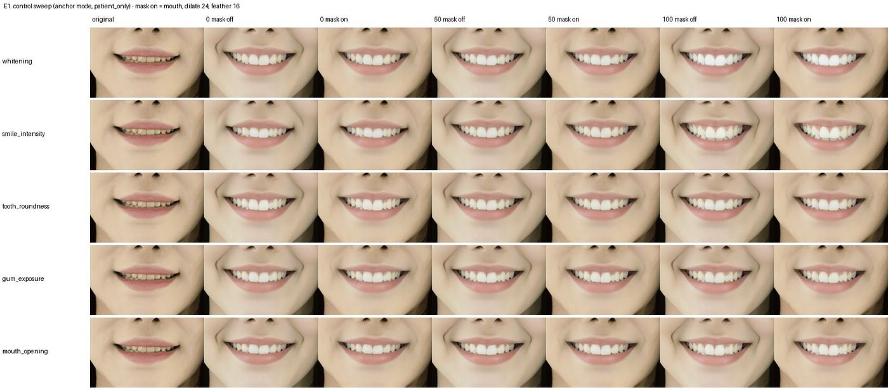
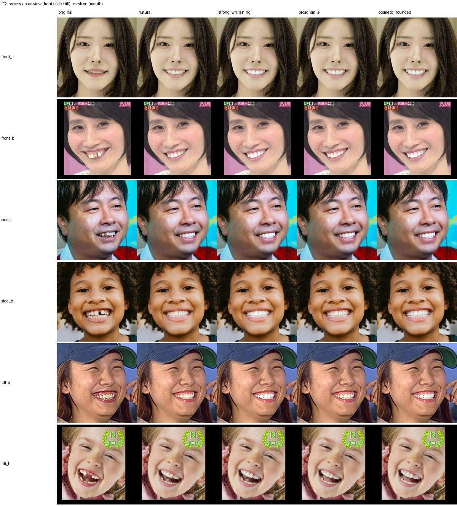
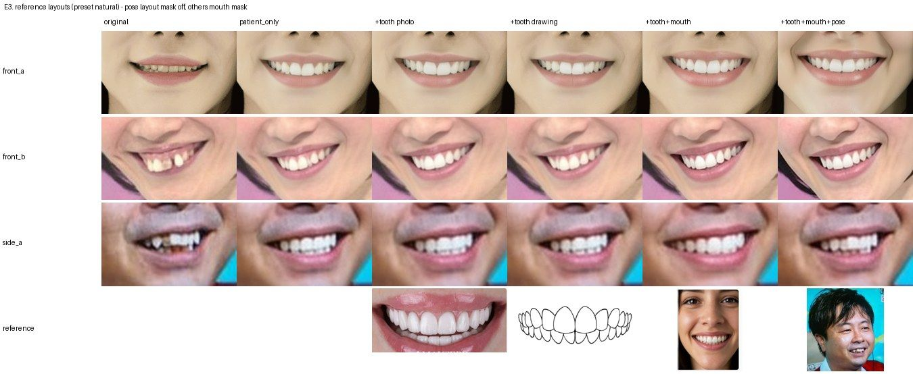
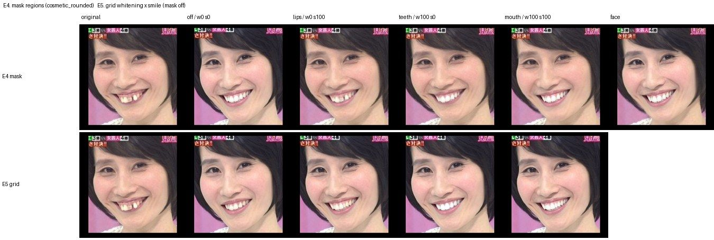

**원인 분석**: 같은 control의 0과 100 임베딩은 cosine 0.998~0.999, 차이 크기는 base의 6~7.5%뿐이다.
512 토큰 프롬프트에서 한 줄만 바뀌기 때문에 신호가 약하고, 공통 지시문("Modify only the teeth")이 우선한다.

## 2. 임베딩 control 강도 (delta 모드)

`base + k × (anchor − base)`, k = 1 / 3 / 6 / 10, 마스크 `face`.

| control | 쓸 만한 범위 | 비고 |
| --- | --- | --- |
| whitening (100) | ×3~×6 | ×10은 입술 색 번짐 |
| smile_intensity (100) | ×3~×6 | ×10은 얼굴 왜곡 |
| tooth_roundness / gum_exposure / mouth_opening | 효과 없음 | ×10에서도 미미 → anchor 문구 재작성 필요 |
| value 0 방향 ("원래 상태 유지") | 효과 없음 | ×6에서도 원본으로 돌아가지 않음 |

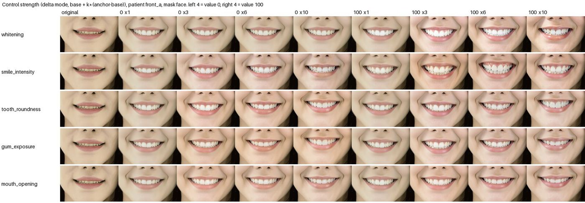
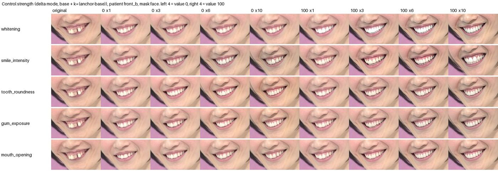

## 3. guidance_scale (CFG)

- 서버 모델(`FLUX.2-klein-4B`)은 `is_distilled: true`라 파이프라인이 `guidance_scale > 1`을 **무시**한다 (학생 모델 증류 때와 같은 문제, `my/predict_distillation.py` 참고).
- `neg=ctrl0`: negative에 빈 프롬프트 대신 "같은 프롬프트, 해당 control만 0"을 넣는 방식. 공통 지시문이 상쇄되어 control 차이만 증폭된다.

| 설정 | 결과 | 시간 |
| --- | --- | --- |
| distilled, gs 1 (현재) | 기준 | 1× |
| distilled + CFG 강제(`is_distilled=False`), gs 2 | 미백이 더 강해짐 | 약 2× |
| 같은 방식, gs 4 | 치아가 파랗게 / 초록빛으로 빛나는 아티팩트 | 약 2× |
| **klein-base-4B, 50 step, gs 4, `neg=ctrl0`** | 해당 control만 바뀌고 원래 치아 형태 유지 (가장 깔끔) | **약 50초/장** |

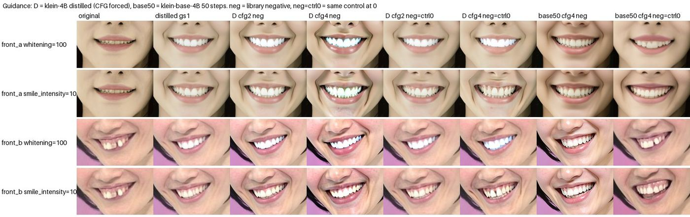

## 4. pose

### 4.1 참조 이미지 방식 (실패)

`patient + pose` layout, 마스크 off. 깨끗한 정면 사진은 참조를 **무시**, 저화질 사진은 참조 속 **사람으로 얼굴이 바뀜**.
템플릿에서 "preserve head pose"를 지워도(`pose_free`) 같다. 이 모델은 다른 사람 사진에서 포즈만 가져오지 못한다.

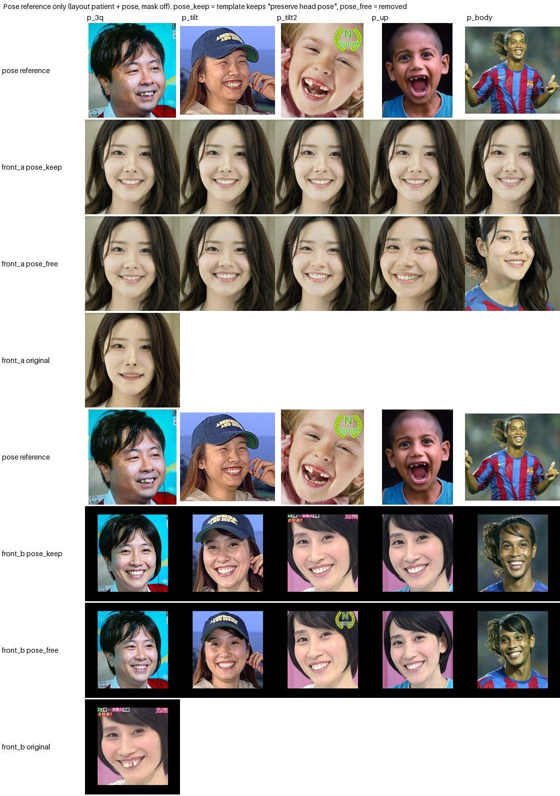

### 4.2 프롬프트 임베딩 방식 (동작)

`head_yaw` / `head_pitch` control 추가, 참조 이미지 없음. ×1에서 좌우 / 위아래가 확실히 바뀐다. ×3~×6은 오히려 정면으로 돌아오거나 변화가 비슷하다.

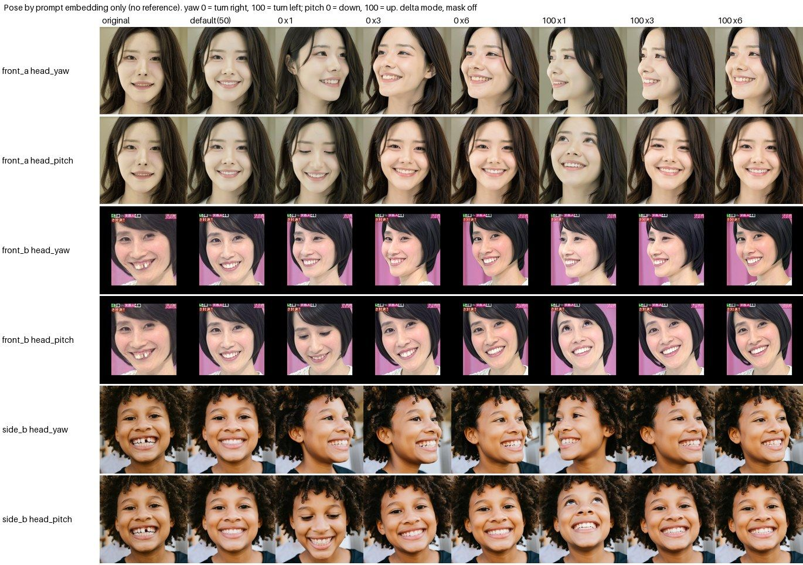

### 4.3 프롬프트 문구 비교

| 버전 | 특징 | 결과 |
| --- | --- | --- |
| v1 `pose_prompt` | "re-render", 기본값 "frontal view", 치아 control 포함 | 단계 조절 됨. 기본값에서도 표정 / 치아 변화 |
| v2 / v3 (pose 전용) | 신원 보존 목록 상세화, 치아 control 제외 | **기본값에서도 고개를 돌림** (front_a −38~−51°). pose가 주 작업이면 "그대로 두라"를 무시 |
| **v3_teeth** (치아 + pose 한 프롬프트) | v3 보존 문구 + 치아 control | 기본값 회전 0~4°, 신원 0.65 / 0.94 / 0.93 (v1: 0.55 / 0.63 / 0.91), 배경 변화 감소 |
| **v4** | v3_teeth에서 **pose 줄을 치아 줄 앞으로** + pitch 문구 강화 | delta 조합 문제 해결, pitch 반응 약 2배. 대신 많이 돌릴수록 신원 하락 |

실험 YAML: [configs/pose_v3_teeth.yaml](configs/pose_v3_teeth.yaml), [configs/pose_v4.yaml](configs/pose_v4.yaml)

### 4.4 한 번에(1-pass) vs 순차(치아 → pose)

| 항목 | 1-pass (v3_teeth) | 순차, 2단계 pose 전용 (v3) | 순차, 2단계 결합 프롬프트 (seqB) |
| --- | --- | --- | --- |
| 기본값 회전 | 0~4° | **크게 돌아감** | 0~4° |
| 단계 조절 (25 vs 0) | 있음 | 약함 | 있음 |
| 의도하지 않은 축 | 4~6° | pitch만 바꿔도 yaw 20~26° | 4~6° |
| 신원 | 높음 | 낮음 | 1-pass와 비슷 |

- pose 전용 프롬프트는 임베딩 차이가 결합 프롬프트보다 약 1.3배 크다 (yaw 0.083 vs 0.065). 하지만 **강도를 ×0.25까지 낮춰도 해결되지 않는다**.
  회전이 control이 아니라 **base 임베딩**에서 나오기 때문이다 (`base + k × diff`에서 k → 0이어도 base가 이미 돌아간 상태).
- 결론: **pose는 전용 프롬프트를 만들지 말고 치아 프롬프트 안의 control로 넣는다.**

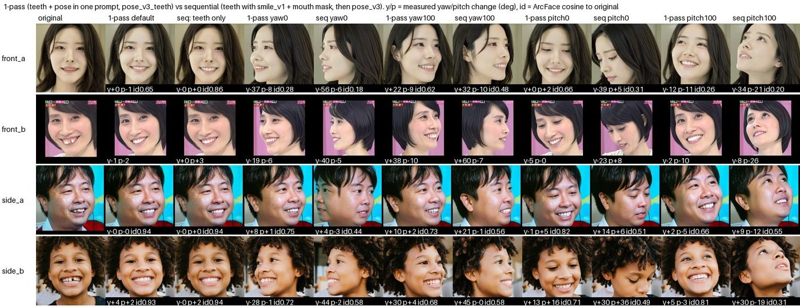
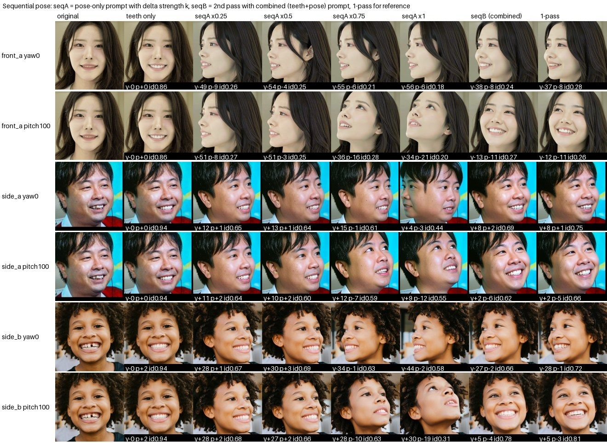

### 4.5 세분화 / grid / delta 조합

- anchor 보간(12.5 간격)으로 중간 각도가 나오지만 **비선형**이다. 37.5~62.5는 거의 안 도는 데드존, 일부 환자는 75→100에서 급변.
- grid(yaw × pitch)는 yaw는 잘 되고 pitch는 약하다. grid에서는 치아 control이 기본값으로 고정된다.
- **delta 조합 문제**: v3c(치아 줄이 앞)에서 미백 ×3 + yaw0을 함께 주면 **회전이 사라진다**.
  Qwen3는 causal LM이라 앞 문장이 뒤 문장의 임베딩까지 바꾸므로, 앞쪽 치아 차이를 증폭하면 뒤쪽 pose 줄이 같이 밀린다 (control 효과가 독립적으로 더해지지 않음).
  → v4(pose 줄을 앞으로)에서 해결. 치아 + pose **조합 preset**(실제 문장으로 미리 인코딩)은 순서와 무관하게 안정적이다.

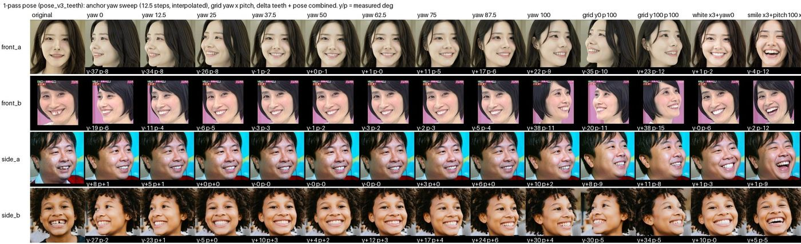
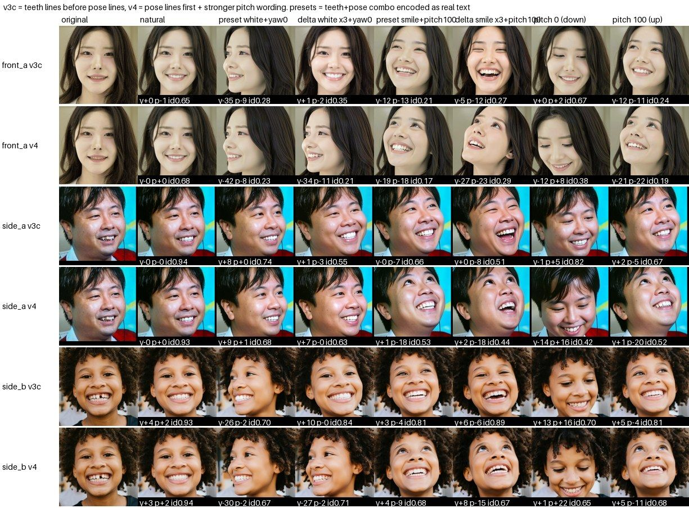

## 5. 측정 지표

| 지표 | 계산 | 주의 |
| --- | --- | --- |
| yaw / pitch 변화 | MediaPipe Face Landmarker의 facial transformation matrix → 각도, 원본과의 차이 | 부호(좌 / 우)는 환자 초기 각도에 따라 다를 수 있음 |
| 신원 유사도 | InsightFace ArcFace(`w600k_r50`) 512차원 임베딩의 cosine. 1.0 동일, 약 0.5 이상 같은 사람 | 고개를 돌리면 같은 사람도 점수 하락. **InsightFace 모델은 비상업 라이선스라 내부 평가 전용** |
| 배경 / 입 변화 | 얼굴(dilate 40) 밖 / 입 영역의 평균 픽셀 차이 | 회전 시 입 위치가 움직여 입 영역 지표는 부정확 |

## 6. 옵션 / 운영 주의사항

- 마스크 기본 추천: `mouth`, dilate 16~24, feather 12~16 (수치 근거는 10.4). 색만 바꾸는 미백은 `teeth + inner_mouth`.
  입 모양을 바꾸는 preset(`broad_smile`, `mouth_opening`)이나 pose 변경은 `face` 또는 마스크 off.
- pose를 바꿀 때는 마스크를 끈다 (원본 기준 마스크라 회전 결과가 잘림).
- 강도 권장: 치아 control ×3~×6 (whitening / smile), pose ×1.
- delta로 여러 control을 섞을 때는 **프롬프트 줄 순서**에 따라 결과가 달라진다. 큰 변화(pose, 메이크업)는 앞에, 치아는 뒤에 둔다.
- 스타일 이름 표기(`smile_v1` vs `smile-v1`)를 빌드와 추론에서 똑같이 쓴다 (라이브러리 경로에 그대로 들어감).
- 빌드 중에는 GPU 락으로 다른 추론이 대기한다.

## 7. 미용(메이크업) 스타일 제안 (→ `smile_v2`로 구현 / 실험, 10장)

| 스타일 | 프롬프트 방향 | 치아와의 관계 |
| --- | --- | --- |
| 내추럴 (노메이크업 메이크업) | 고른 피부 톤, 자연스러운 눈썹, 혈색 립(MLBB) | 미백과 가장 잘 어울리는 기본형 |
| 데일리 코랄 | 얇은 아이라인, 코랄 블러셔, 코랄 립 | 따뜻한 톤 → 치아가 덜 누래 보임 |
| 글로우 (물광) | 촉촉한 피부결, 하이라이터, 누드 핑크 글로스 | 웃는 사진에서 화사함 |
| 포멀 / 웨딩 | 정돈된 눈썹, 브라운 스모키, 로즈 립, 세미 매트 | 촬영용 상담 시뮬레이션 |
| 볼드 레드립 (글램) | 윙 아이라인, 선명한 레드 립 | 레드 립 대비로 치아가 더 하얘 보임 (대비 효과 확인용) |

구현 방향: preset 5종 + `makeup_intensity` control(0~100). 메이크업 줄은 치아 줄보다 **앞**에 둔다. 신원 보존 문구 유지, 마스크 `face`.

## 8. 임베딩 용량 최적화

### 8.1 현재 크기

- 임베딩 1개 = `[1, 512, 7680]` bf16 = **7.9MB** (Qwen3 9 / 18 / 27층 출력 2560차원 × 3 연결).
- 실제 프롬프트는 145~193 토큰이고 나머지 약 320개는 padding이다. padding 위치 값도 프롬프트마다 달라 단순히 잘라낼 수는 없다.
- `smile_v1`: 6 layout × 57 = 342 항목(base 6, preset 36, anchor 150, **grid 150**), 고유 파일 228개, 1.8GB.

### 8.2 layout 수가 용량을 곱한다

layout당 항목 수 = `1 + preset 수 + Σ anchor 수 + Σ (grid anchor 수²)`, 전체 = 그 값 × layout 수.

| 구성 (smile_v1 + pose 2 + 메이크업 5 + grid 2개) | 항목 / layout | patient_only만 | layout 6개 |
| --- | --- | --- | --- |
| 현재 형식 (7.9MB) | 약 106 (고유 약 85) | **약 0.7GB** | 약 4GB |
| fp8 + 256 토큰 (약 2MB, 미검증) | 동일 | 약 0.2GB | 약 1GB |

권장:

1. **실제로 쓰는 layout만 빌드**한다 (빌드 API `layouts` 옵션). 참조 이미지 layout(치아 / 입 / 포즈)은 E3 / 4.1 결과상 효과가 제한적이므로 우선순위를 낮춘다.
2. grid는 꼭 필요한 조합만 둔다 (grid 1개 = layout당 25개, 전체의 44%).
3. 자주 쓰는 조합은 grid 대신 **조합 preset**으로 만든다 (정확하고 1개만 차지).

### 8.3 형식 축소 (미검증)

| 방법 | 1개 용량 | 측정 / 예상 |
| --- | --- | --- |
| fp8(e4m3) 저장 → 로드 시 bf16 복원 | 3.9MB | 상대 오차 1.0% (control 신호 7.5% 대비 작음) |
| `max_sequence_length` 256 (최대 193 토큰) | 3.9MB | padding 감소로 결과가 약간 달라질 수 있음. 추론도 빨라짐 |
| 둘 다 | 약 2MB | 이미지 비교 필요 |

## 9. 다음 실험

| 우선순위 | 실험 | 목적 |
| --- | --- | --- |
| 1 | pose 줄 선두(v4) 문구를 smile_v1에 반영 + pitch 문구를 v3와 v4 중간 세기로 | pose 조합 안정화, 신원 하락 완화 |
| 2 | yaw / pitch anchor를 각도 단위로 촘촘하게 (예: 10° 단위) | 데드존 / 비선형 해소 |
| 3 | `tooth_roundness`, `gum_exposure`, `mouth_opening` anchor 문구 재작성 | 효과 없는 control 살리기 |
| 4 | 메이크업 preset 5종 + `makeup_intensity` | 미용 스타일 추가 |
| 5 | distilled + `neg=ctrl0` CFG gs 1.25~3 구간, base-4B 20~30 step | 아티팩트 경계와 속도 / 품질 균형 |
| 6 | 임베딩 fp8 + 256 토큰 이미지 비교 | 디스크 / 로드 용량 1/4 |
| 7 | VAE tiling(512) 실제 사진 경계 확인 → `--vae-tile-size` 추가 | 최대 VRAM 6.7GB → 약 5.9GB |
| 8 | 얼굴 크롭 512px 생성 모드 품질 비교 | VRAM 4.8GB, 속도 약 3.5배 |
| 9 | 공식 fp8 체크포인트(scale 포함) vs 현재 fp8 저장 vs bf16 | 운영 배포 가중치 결정, Ada 이상 GPU에서 fp8 연산 |

## 10. smile_v2: 치아 스타일 / 메이크업 / 마스크와 신원

실험 YAML: [configs/smile_v2.yaml](configs/smile_v2.yaml). 앞 실험의 교훈을 반영했다.

- 치아를 **색(`tooth_color`)**과 **배열(`alignment`)** control로 분리한다. 구조 유지 문구("모양 / 크기 / 위치 / 틈 / 배열을 그대로")는 `alignment 0`에 둔다
  (색 anchor에 넣으면 교정 + 미백 조합에서 문장이 충돌한다).
- 메이크업 줄을 치아 줄보다 **앞**에 둔다 (`makeup_style` 0~5 범주형 + `makeup_intensity`).
- 사용 형태는 실제 문장으로 미리 인코딩한 preset이다: `whitening_only`, `whitening_natural`, `align_only`, `align_snaggle`, `align_whiten`,
  `makeup_natural / coral / glow / formal / glam`, `glow_whiten`.
- patient_only 1 layout, 57 항목, 빌드 14초.

신원 수치는 ArcFace cosine 평균 (5장 참고, 1.0 = 동일).

### 10.1 색만 바꾸는 미백 (발치 없이 누렇고 약간 삐뚤어진 치아 5명)

| 설정 | 신원 | 결과 |
| --- | --- | --- |
| v1 `strong_whitening` (mouth 마스크) | 0.833 | 치아를 이상적인 새 치아로 바꾸고 **입 모양 / 표정까지 바뀜** (벌린 입이 다문 미소로) |
| v2 `natural` (색 0, 배열 0) | 0.957 | 원래 치아 그대로 유지 → v1과 달리 "유지" 지시가 동작 |
| v2 `whitening_only` (mouth 마스크) | 0.910 | 입 모양은 유지. 다만 치아 배열이 일부 정돈되고, mouth 마스크라 **입술 색까지 바뀌는 경우**(회색 톤)가 있음 |
| **v2 `whitening_only` (teeth 마스크)** | **0.925** | 입술은 원본 유지, 치아만 하얘짐. 가장 의도에 가까움 |
| v2 색 100 ×3 (delta) | 0.874 | 입술이 파랗게 변하는 등 아티팩트 → 사용 금지 |

한계: 생성 모델이라 마스크 안에서는 치아 모양을 다시 그린다. **치아 배열을 픽셀 단위로 완전히 보존**해야 하면 생성 대신
teeth 마스크 안에서 LAB 색 보정(비생성 미백)을 하는 방식을 별도 옵션으로 검토한다.

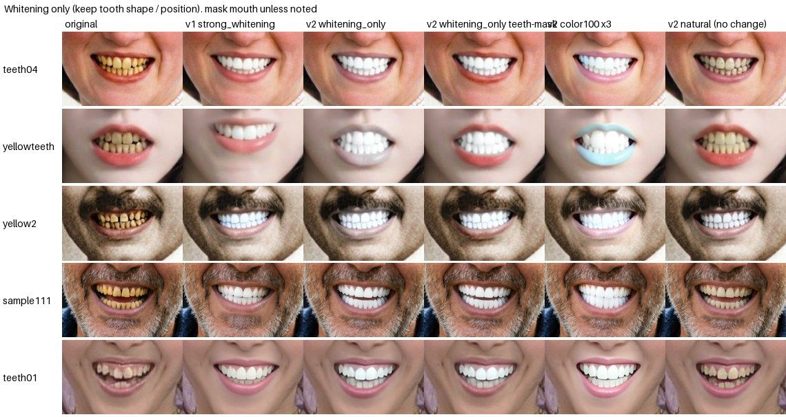

### 10.2 덧니 / 삐뚤어진 치아만 가지런히 (교정처럼, 6명)

| 설정 | 신원 | 결과 |
| --- | --- | --- |
| `natural` | 0.958 | 대부분 원래 배열 유지 |
| `align_snaggle` (50) | 0.967 | 송곳니 덧니(sample18), 겹친 앞니(teeth06, teeth01)가 정렬됨. **원래 치아 색은 유지** |
| `align_only` (100) | 0.961 | 50과 비슷하거나 조금 더 고르게 |
| 배열 100 ×2 (delta) | 0.923 | 치아가 누렇게 변하는 부작용 |
| `align_whiten` | 0.940 | 정렬 + 미백 동시에 잘 됨 |

- 교정은 기대보다 잘 동작한다. ×1 preset으로 충분하고 강도를 올리면 색이 틀어진다.
- sample21(아래 앞니 겹침)은 일부만 정렬된다. 아래 치아 / 심한 겹침은 추가 확인이 필요하다.

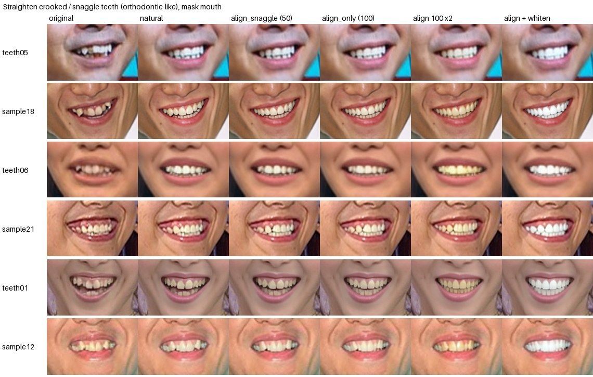

### 10.3 메이크업 5종 (성인 여성 4명, face 마스크)

| preset | 신원 | 결과 |
| --- | --- | --- |
| natural | 0.689 | 피부 톤이 고르게, 변화 작음 |
| coral | 0.777 | **볼에 코랄 블러셔가 진한 원형으로 들어감** → 문구 완화 필요 |
| glow | 0.673 | 광대 하이라이트가 과함 → 문구 완화 필요 |
| formal | **0.551** | 눈 화장 / 피부 질감 변화가 커서 **신원 하락이 가장 큼** |
| glam | 0.695 | 윙 아이라인 + 레드 립이 선명함. 치아 색은 그대로 유지(색 0) |
| glow + whiten | 0.660 | 메이크업과 미백이 함께 적용됨 |
| glam intensity 0 / 100 | 0.704 / 0.725 | **intensity 0에서도 glam이 적용됨** → intensity control은 거의 효과 없음 |

- 스타일 구분은 확실하지만 전반적으로 **과하다**. "subtle", "sheer" 같은 약한 표현으로 바꾸고, 블러셔 / 하이라이트 위치와 양을 구체적으로 쓴다.
- intensity는 별도 줄보다 각 스타일 문장 안에 강도를 넣은 preset(예: `glam_light`, `glam_full`)으로 나누는 편이 낫다.
- 메이크업은 얼굴 전체를 바꾸므로 신원 0.55~0.78로 치아 편집(0.91~0.96)보다 낮다. 상담용으로 쓰려면 "keep facial features" 문구 보강이 필요하다.

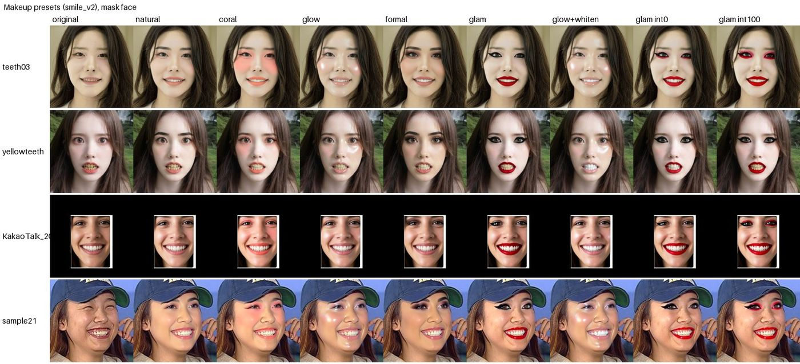

### 10.4 마스크 범위와 신원 (11명 × 3설정 × 마스크 4종 = 132장)

| 설정 | 마스크 | 신원 평균 | 신원 최저 | 입 밖 얼굴 변화 (0~255) | 배경 변화 |
| --- | --- | --- | --- | --- | --- |
| v1 `strong_whitening` | off | 0.817 | 0.603 | 13.2 | 11.9 |
| | face | 0.813 | 0.584 | 12.1 | 0.3 |
| | mouth | 0.875 | 0.709 | 0.3 | 0.0 |
| | teeth | **0.928** | **0.871** | 0.0 | 0.0 |
| v2 `whitening_only` | off | 0.864 | 0.649 | 13.3 | 11.4 |
| | face | 0.858 | 0.637 | 12.2 | 0.3 |
| | mouth | 0.925 | 0.891 | 0.2 | 0.0 |
| | teeth | **0.942** | **0.898** | 0.0 | 0.0 |
| v2 `align_whiten` | off | 0.891 | 0.703 | 11.0 | 11.2 |
| | face | 0.886 | 0.693 | 10.0 | 0.3 |
| | mouth | 0.932 | 0.887 | 0.2 | 0.0 |
| | teeth | **0.944** | **0.898** | 0.0 | 0.0 |

- **마스크 범위가 좁을수록 신원이 좋아진다: teeth > mouth > off ≈ face.**
- `face` 마스크는 배경만 지켜 주고 얼굴 안 변화(입 밖 10~12)는 그대로라 **신원 개선 효과가 거의 없다**.
- `mouth` 마스크만으로 입 밖 얼굴 변화가 0.2로 사라지고, 최저 신원이 0.6~0.7대에서 0.89까지 올라간다.
- 프롬프트 개선(v2)만으로도 마스크 off 신원이 0.817에서 0.864~0.891로 오른다. 프롬프트와 마스크 효과는 겹쳐서 쌓인다.
- 주의: **teeth 마스크는 생성 결과의 입 모양이 원본과 다를 때 어긋난다** (yellowteeth + v1: 원본은 벌린 입인데 생성은 다문 미소 →
  원본 입 안 위치에만 합성되어 부자연스러움). 입 모양을 유지하는 v2 프롬프트와 함께 쓴다.

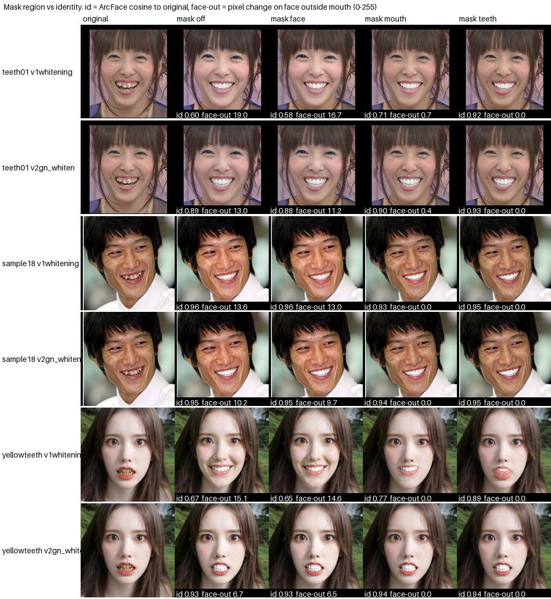

### 10.5 smile_v2 기준 다음 단계

1. 메이크업 문구 완화 (coral 블러셔, glow 하이라이트), formal 신원 보강, intensity를 preset 단계로 분리
2. 비생성 미백 옵션 (teeth 마스크 안 LAB 색 보정) 추가 후 생성 미백과 비교
3. 아래 앞니 겹침 / 심한 crowding 케이스 교정 문구 보강
4. smile_v2 구조(색 / 배열 분리, 메이크업 / pose 줄 선두)를 smile_v1에 통합할지 결정

## 11. MICE (영역별 지시문 동시 편집)

구현 / 사용법은 [README 5.2](README.md#52-mice-영역별-지시문-동시-편집), 실험 YAML은 [configs/smile_v2_mice.yaml](configs/smile_v2_mice.yaml)
(smile_v2 + 전역 지시문 1개 + 영역 지시문 9개: teeth_white / teeth_align / teeth_align_white / lips_coral / lips_red / lips_nude_gloss / eyes_liner / eyes_smoky / cheeks_blush).

비교 대상: 미백 5명, 교정 6명, 다중 영역 메이크업 4명. 수치는 평균. "영역 밖 변화"는 편집 영역(dilate 4%)을 뺀 얼굴의 픽셀 차이(0~255).

### 11.1 비용 (먼저 측정)

| 설정 | 최대 VRAM | 시간 | 비고 |
| --- | --- | --- | --- |
| bias 없음 | 6.69GB | 3.9~4.0초 | |
| 전부 0인 bias | 6.83GB | 5.2초 | 결과 차이 0.2/255 → 주입 경로 정상 |
| MICE 1영역 (200 토큰) | 6.99GB | 5.3초 | |
| MICE 3영역 (200 토큰) | 7.04GB | 5.7초 | |

VRAM은 bias 행렬(약 150MB)만큼만 는다. 시간은 flash 커널을 못 써서 +35~43%. MICE가 아닌 요청은 영향이 없다.

### 11.2 지시문 토큰 수

공개 코드처럼 지시문당 200 토큰(padding 포함)을 쓰는 것이 실제 토큰만 쓰는 것보다 **확실히 낫다**
(padding 제거 시 치아가 푸르게 빛나고 눈가 색이 번짐). 512는 200과 비슷하고 더 느리다 → 기본 200.

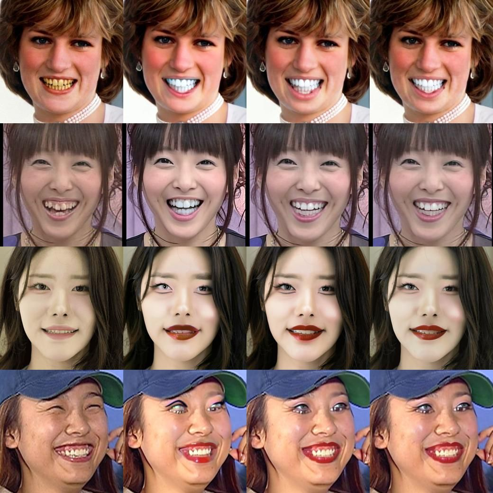

### 11.3 결과

| 실험 | 방식 | 신원 | 영역 밖 변화 | 관찰 |
| --- | --- | --- | --- | --- |
| 미백 | 마스크 없음 | 0.847 | 15.4 | 피부 / 입술까지 바뀜 |
| | v2 프롬프트 + composite (teeth) | 0.925 | 0.0 | 깨끗한 미백, 치아 배열 일부 정돈 |
| | MICE | 0.870 | 15.5 | 입술 / 피부 톤까지 바뀜 |
| | **MICE + composite** | **0.937** | 0.0 | 자연스러운 미백, **원래 치아 배열을 더 잘 유지** |
| 교정 | **v2 프롬프트 + composite (mouth)** | **0.961** | 0.6 | **정렬이 가장 잘 됨** |
| | MICE | 0.820 | 15.2 | 정렬 약함, 입술 왜곡 (teeth01, sample12) |
| | MICE + composite | 0.934 | 0.0 | 덧니가 남는 경우 (teeth05) |
| 메이크업 | v2 glam 프롬프트 + composite (face) | 0.695 | 12.5 | 효과는 강하지만 얼굴 전체가 바뀜 |
| | MICE 레드 립 + 아이라인 + 블러셔 | 0.780 | 18.6 | |
| | MICE 위 3영역 + composite | 0.812 | 0.0 | 레드 립 좋음, 아이라인 약함, **블러셔가 둥근 얼룩** |
| | MICE 코랄 립 + 블러셔 + composite | 0.886 | 0.0 | 은은함, 블러셔 얼룩 동일 |
| | **MICE 치아 미백 + 레드 립 + composite** | **0.924** | 0.2 | **치아와 입술을 서로 섞이지 않게 동시에 편집** |

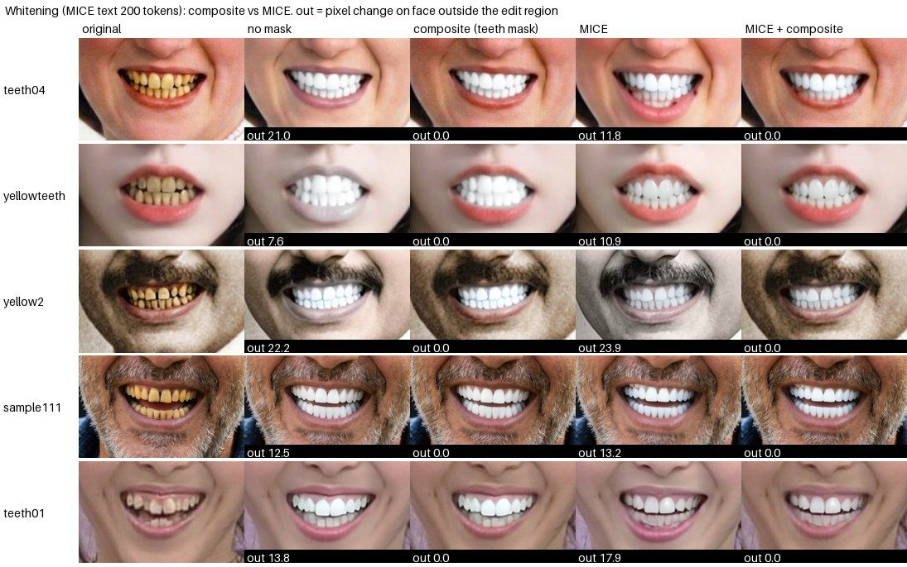
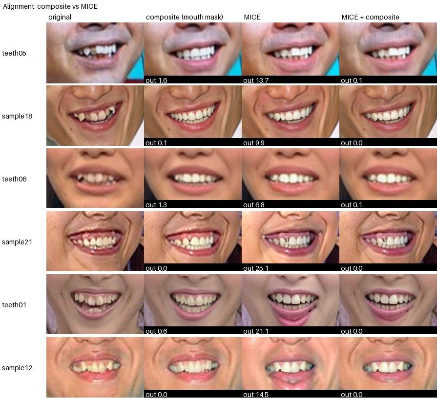
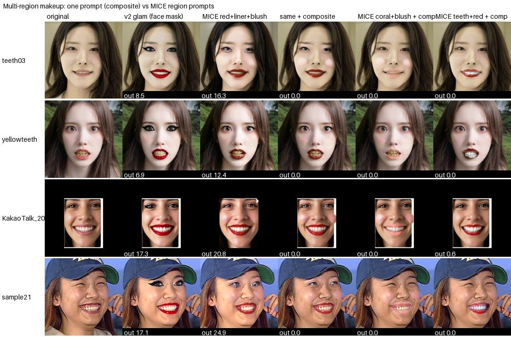

### 11.4 결론

- MICE는 **영역끼리 편집이 섞이지 않게** 하는 방법이고, 픽셀 보존은 하지 않는다 (배경 차이 11~23, 논문의 Klein 4B 배경 MAE 7.84와 같은 수준).
  운영에서는 **MICE + composite**로 쓴다.
- **여러 영역을 동시에 바꿀 때 가장 유리**하다 (치아 미백 + 립 색상: 신원 0.924, 한 프롬프트 glam은 0.695).
- 치아 한 영역만 바꾸는 작업은 v2 프롬프트 + composite가 같거나 낫고 더 빠르다. 미백은 MICE + composite가 치아 배열을 더 잘 지켜 근소하게 낫고,
  교정은 v2 프롬프트가 낫다.
- 남은 문제: `cheeks` 원형 마스크 → 블러셔가 둥근 얼룩. 아이라인 지시문 효과가 약함.

### 11.5 다음 단계

1. `cheeks` 영역을 광대 랜드마크 다각형 + 넓은 feather로 바꾸고 블러셔 지시문 완화
2. 아이라인 / 아이섀도 지시문 강화 (강도 표현, 위치 구체화)
3. 교정 지시문을 MICE용으로 재작성 (현재는 v2 프롬프트가 우세)
4. 속도: `mice_steps`(앞 2스텝만 적용)와 지시문 토큰 수(200 → 128)의 품질 / 시간 절충 측정

### 11.6 아랫니 뭉개짐 수정

증상: MICE에서 간헐적으로 아랫니 / 입 안쪽이 뭉개짐.
원인: 마스크를 토큰 격자(16px)로 줄일 때 **50% 이상 덮은 칸만 영역으로 배정**해서, 아랫니 끝과 입 구석 칸이 배경으로 빠졌다.
배경 칸은 전역 지시문("그대로 유지")만 보고 옆 치아 칸을 참조하지 못해, 새로 그린 윗니와 원래 아랫니가 섞였다.

| 버전 | 설정 | 결과 |
| --- | --- | --- |
| V0 | 배정 기준 50%, 배경 → 영역 차단 | 아랫니 뭉개짐, 입술 색도 바뀜 |
| V1 | 배정 기준 25% | 일부 개선 |
| **V2 (기본값)** | 25% + 배경 칸도 영역 칸을 약한 패널티(-1)로 참조 | **아랫니 또렷, 입술 원래 톤 유지** |

`MiceAttention(coverage=0.25, background_context=True)`가 기본값이다.

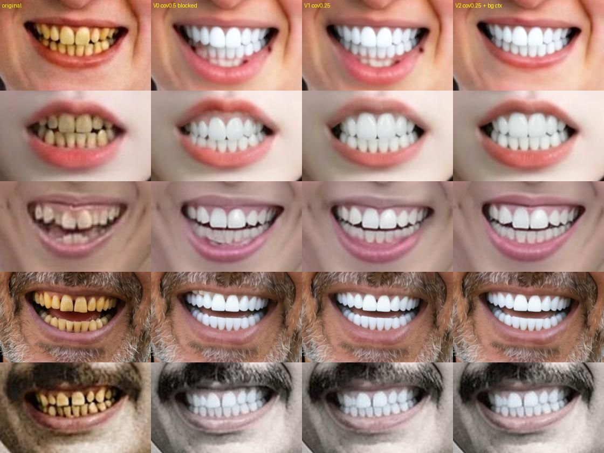

### 11.7 메이크업 문구 재작성 (smile_v3b)

smile_v2 메이크업은 "bold", "sharp winged", "vivid", "highlighter" 같은 표현 때문에 과하고 부자연스러웠다.
[configs/smile_v3b.yaml](configs/smile_v3b.yaml)에서 다음을 바꿨다.

- "아주 옅게, 자연스럽게, 원래 피부결 유지, 경계가 보이지 않게" 위주로 재작성, 효과 없던 `makeup_intensity` 제거
- **볼(블러셔 / 광택) 표현 전부 제거**: 4 step 모델이 볼 색을 둥근 얼룩으로 그려서 문구 / 마스크 조정으로 해결되지 않았다 (중간 버전 smile_v3에서 확인)
- 아이라인은 "윙 없이 아주 얇게"
- `cheeks` 마스크는 원형 → 광대 랜드마크 다각형으로 변경 (현재 스타일에서는 사용하지 않음)

| 방식 | 결과 |
| --- | --- |
| 한 프롬프트 + face 합성: natural, coral | 자연스러움 |
| 한 프롬프트: soft pink | 분홍색이 눈가 / 볼로 번짐 → 사용 비추천 |
| 한 프롬프트: formal, classic red | "윙 없이"를 넣어도 아이라인이 두껍게 나오는 경우 있음 |
| **MICE + composite: 누드 글로스 / 코랄 + 아이라인 / 레드 립 + 아이라인 / 치아 미백 + 코랄** | **4종 모두 깔끔하고 번짐 없음** |

결론: 메이크업은 **MICE + composite**로 영역(입술, 눈가)을 나눠 적용하는 것이 가장 자연스럽다.

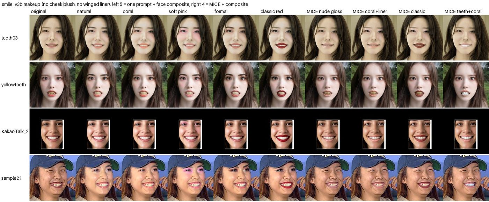

## 12. 파라미터 최적화 정리 (권장값)

지금까지 실험의 결론을 파라미터별로 모았다. 기본 스타일 3개(README 7.3)는 이 값을 기준으로 만들었다.

### 12.1 모델 / 추론

| 파라미터 | 권장 | 근거 |
| --- | --- | --- |
| 모델 | FLUX.2 Klein 4B (step-distilled), 4 step | 장당 약 1~4초. base-4B 50 step은 약 50초 |
| `guidance_scale` | 1 (사용 안 함) | distilled 모델은 CFG가 무시됨. 강제로 켜면 gs 4에서 치아 푸른빛 / 초록빛 아티팩트 (3장) |
| `--fp8-weights` | on | VRAM 10.5 → 6.7GB, 속도 +2%, 품질 차이 2.4/255 (README 9장) |
| 해상도 | 원본 그대로 (최대 1MP) | 얼굴 폭 60px 이상 필요, 35px 이하에서는 치아 분리 불가 (face parsing 실험) |
| seed | 고정해서 비교 | 결과 비교 / 재현용 |

### 12.2 임베딩 강도 (delta 모드)

| 대상 | 권장 강도 | 근거 |
| --- | --- | --- |
| 미백, 웃음 강도 | ×3~×6 (smile_v1) | ×10은 입술 색 번짐 / 얼굴 왜곡 (2장) |
| smile_v2+ `tooth_color` | ×1 (preset) | ×3에서 입술이 푸르게 변함 (10.1) |
| `alignment` (교정) | ×1 (preset) | ×2에서 치아가 누렇게 변함 (10.2) |
| pose (`head_yaw` / `head_pitch`) | ×1 | ×3 이상은 정면으로 돌아오거나 얼굴이 무너짐 (4.2) |
| tooth_roundness / gum_exposure / mouth_opening | 효과 없음 | ×10에서도 미미 → 사용하지 않음 |

### 12.3 프롬프트 구조

| 규칙 | 근거 |
| --- | --- |
| 공통 지시문에 "같은 사람 / 표정 / 입 벌림 / 배경 유지"를 명시 | v1 대비 신원 0.817 → 0.864~0.891 (10.4) |
| 치아는 색(`tooth_color`)과 배열(`alignment`)을 분리, 구조 유지 문구는 `alignment 0`에 | 색 anchor에 넣으면 교정 + 미백 조합에서 충돌 (10장) |
| 큰 변화(pose, 메이크업) 줄을 치아 줄보다 **앞에** | 뒤에 두면 delta 조합 시 앞쪽 치아 강도에 덮어써짐 (4.5) |
| pose는 참조 이미지가 아니라 프롬프트 control로 | 참조 이미지는 얼굴이 바뀌거나 무시됨 (4.1) |
| pose 전용 프롬프트를 따로 만들지 않음 | 기본값에서도 고개를 돌림, 강도를 낮춰도 해결 안 됨 (4.4) |
| 자주 쓰는 조합은 grid 대신 조합 preset | 실제 문장 인코딩이라 정확하고 1개만 차지 (4.5, 8.2) |
| 메이크업은 "아주 옅게, 원래 피부결 유지, 경계 없이", 볼 표현 금지, 아이라인 "윙 없이" | 과한 표현 / 볼 얼룩 (11.7) |

### 12.4 마스크

| 작업 | 권장 | 근거 |
| --- | --- | --- |
| 미백만 | composite, `teeth + inner_mouth`, dilate 3, feather 4 | 신원 0.925~0.942, 입술 색 보존 (10.4) |
| 교정 / 교정 + 미백 | composite, `mouth`, dilate 16, feather 12 | 신원 0.961 (11.3) |
| 치아 + 입술 / 눈가 동시 | MICE + composite, feather 12 | 섞임 없음, 신원 0.924 (11.3, 11.7) |
| pose 변경 | 마스크 off | 원본 기준 마스크라 회전 결과가 잘림 |
| `face` 마스크 | 배경만 보호, 신원 개선 효과 거의 없음 | (10.4) |

### 12.5 MICE

| 파라미터 | 권장 | 근거 |
| --- | --- | --- |
| `text_tokens` | 200 | padding 제거 시 치아 푸른빛 / 색 번짐, 512는 비슷하고 느림 (11.2) |
| `coverage` / `background_context` | 0.25 / true (코드 기본값) | 아랫니 뭉개짐 해결 (11.6) |
| `kernel_size` / `temperature` | 11 / 3.0 | temperature 1~8 차이 작음 |
| `composite` | true | MICE만으로는 배경 픽셀 미보존 (11.4) |
| 비용 | 시간 +35~43%, VRAM +0.3GB | MICE가 아닌 요청은 영향 없음 (11.1) |

### 12.6 운영

| 항목 | 권장 |
| --- | --- |
| 빌드 | `--build-device`로 추론과 다른 GPU에서 (빌드 중에도 추론 가능, 빌드 후 VRAM 전부 반환) |
| layout | 실제로 쓰는 layout만 빌드 (layout 수만큼 용량이 곱해짐) |
| 임베딩 용량 | fp8 저장 + 256 토큰으로 1/4 가능 (미검증, 9장 다음 실험) |
