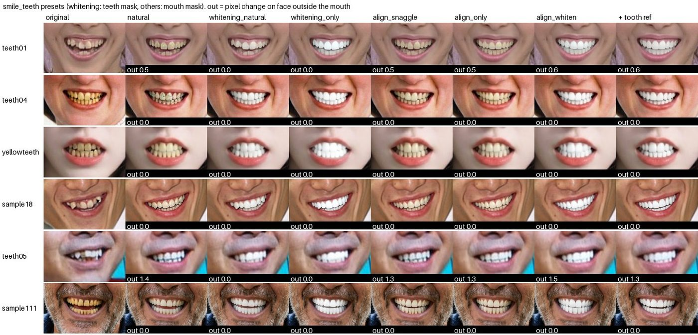
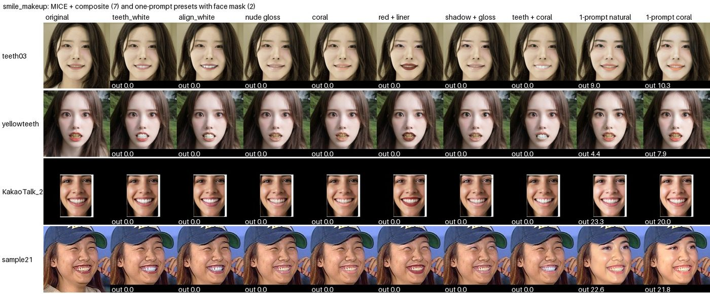
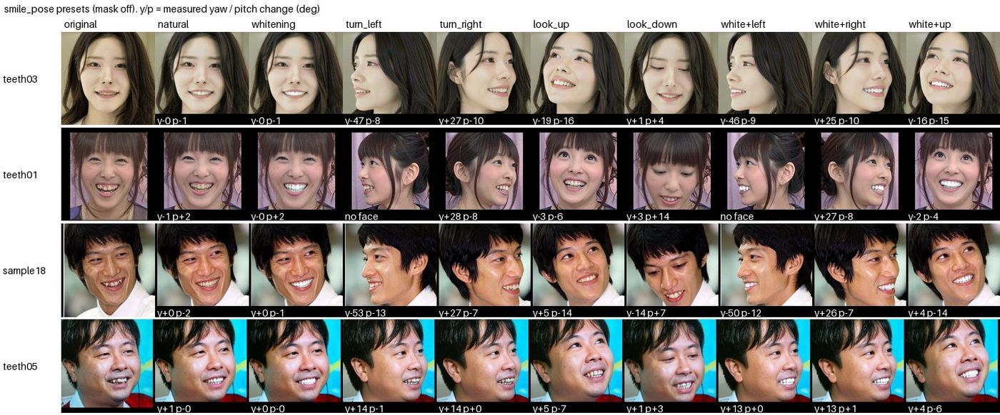

# 기본 스타일(preset) 결과

[README 7.3](README.md#73-기본-스타일)의 기본 스타일 3개(`my/configs/smile_design/smile_teeth.yaml`, `smile_makeup.yaml`, `smile_pose.yaml`)를
YAML 상단 주석의 권장 요청 방식 그대로 추론한 결과다. 파라미터 선정 근거는 [experiments.md 12장](experiments.md#12-파라미터-최적화-정리-권장값)을 본다.

- 환경: RTX A6000 (GPU 2, 3), FLUX.2 Klein 4B, 4 step, fp8 가중치 저장, seed 0
- 이미지: `my/samples/faces/samples`, 치아 템플릿 `my/samples/dentals/matmatAlpa.png`
- 총 114장, 2 GPU 병렬 189초

지표:

| 지표 | 계산 |
| --- | --- |
| 신원 | InsightFace ArcFace cosine (원본 대비, 1.0 = 동일). **내부 평가 전용** (비상업 라이선스 모델) |
| 영역 밖 변화 | 편집 영역(치아: `mouth`, 메이크업: 입술 + 눈가 + 치아, dilate 4%)을 뺀 얼굴의 평균 픽셀 차이 (0~255) |
| yaw / pitch | MediaPipe facial transformation matrix로 측정한 고개 각도 변화 (도) |
| 시간 | 서버 요청 1건 (HTTP 포함), 이미지 크기에 따라 다름 |

## 1. smile_teeth (치아 미백 / 교정)

대상: 발치 없이 삐뚤거나 누런 치아 6명 (teeth01, teeth04, yellowteeth, sample18, teeth05, sample111).
미백 preset은 `teeth + inner_mouth` 마스크(dilate 3, feather 4), 나머지는 `mouth` 마스크(dilate 16, feather 12).

| preset | 신원 평균 (최저) | 영역 밖 변화 | 시간 | 관찰 |
| --- | --- | --- | --- | --- |
| `natural` | 0.963 (0.940) | 0.3 | 3.5초 | 원래 치아 유지. teeth04는 치아에 작은 얼룩이 생김 |
| `whitening_natural` | 0.956 (0.943) | 0.0 | 3.5초 | **자연스러운 흰색. 가장 무난한 미백** |
| `whitening_only` | 0.928 (0.907) | 0.0 | 3.0초 | 아주 밝은 흰색. 치아 모양이 다소 정돈됨 |
| `align_snaggle` | 0.962 (0.924) | 0.3 | 3.0초 | 덧니(sample18), 겹친 앞니(teeth01) 정렬, **원래 색 유지** |
| `align_only` | 0.957 (0.921) | 0.3 | 3.0초 | snaggle과 비슷 |
| `align_whiten` | 0.920 (0.879) | 0.4 | 3.0초 | 정렬 + 미백 동시 |
| `align_whiten` + 치아 템플릿 (`patient_tooth`) | 0.915 (0.873) | 0.3 | 4.1초 | 템플릿 없는 버전과 큰 차이 없음, 1초 느림 |

정리:

- 미백은 `whitening_natural`을 기본으로, 더 밝게 원하면 `whitening_only`.
- 교정은 `align_snaggle`(50)과 `align_only`(100)의 차이가 작다. 송곳니 덧니와 겹친 앞니는 잘 정렬된다.
- **teeth05(이가 빠지거나 크게 벌어진 경우)는 교정 효과가 약하다.** 발치 / 결손 케이스는 대상에서 제외하거나 별도 문구가 필요하다.
- 치아 템플릿 참조 layout은 효과 대비 시간만 늘어서 기본 사용은 권장하지 않는다.

## 2. smile_makeup (치아 + 입술 + 눈가, MICE)

대상: 성인 여성 4명 (teeth03, yellowteeth, KakaoTalk, sample21).
MICE 7종은 `mask: {"mode": "mice", "composite": true, "feather": 12, "dilate": 4}`, 한 프롬프트 2종은 `face` 마스크(feather 12).

| 설정 | 신원 평균 (최저) | 영역 밖 변화 | 시간 | 관찰 |
| --- | --- | --- | --- | --- |
| MICE `teeth_white` | **0.972** (0.957) | 0.0 | 4.5초 | 자연스러운 미백. yellowteeth는 약간 푸른 기 |
| MICE `teeth_align_white` | 0.958 (0.949) | 0.0 | 4.5초 | 정렬 + 미백 |
| MICE `lips_nude_gloss` | 0.967 (0.949) | 0.0 | 4.5초 | 변화가 아주 옅어 잘 안 보임 |
| MICE `lips_coral` | 0.961 (0.929) | 0.0 | 4.5초 | 은은한 코랄 |
| MICE `lips_red` + `eyes_liner` | 0.926 (0.890) | 0.0 | 4.6초 | **레드 립이 선명하고 자연스러움**, 아이라인은 얇게 |
| MICE `eyes_soft_shadow` + `lips_nude_gloss` | 0.916 (0.841) | 0.0 | 4.7초 | 옅음 |
| MICE `teeth_white` + `lips_coral` | 0.929 (0.928) | 0.0 | 4.7초 | 치아와 입술이 섞이지 않고 동시에 적용 |
| 한 프롬프트 `makeup_natural` | 0.715 (0.491) | 14.8 | 3.6초 | **얼굴 전체가 바뀜** (sample21은 눈이 커짐) |
| 한 프롬프트 `makeup_coral` | 0.835 (0.617) | 15.0 | 3.6초 | 동일 |

정리:

- **MICE + composite가 모든 지표에서 우세하다** (신원 0.92~0.97, 영역 밖 변화 0). 한 프롬프트 메이크업은 얼굴 전체를 바꿔 신원이 0.49까지 떨어진다.
- 누드 글로스와 아이섀도는 너무 옅어서 효과가 잘 안 보인다. 문구를 조금 강하게 하는 조정이 필요하다.
- 한 프롬프트 preset(`makeup_natural`, `makeup_coral`)은 YAML에서 빼는 것을 고려한다.

## 3. smile_pose (치아 + 고개 방향)

대상: 성인 4명 (teeth03, teeth01, sample18, teeth05). 마스크 off.

| preset | 신원 평균 | yaw 변화 (teeth03 / teeth01 / sample18 / teeth05) | pitch 변화 | 시간 |
| --- | --- | --- | --- | --- |
| `natural` | 0.911 | 0 / −1 / 0 / +1 | ≈0 | 2.3초 |
| `whitening` | 0.906 | ≈0 | ≈0 | 2.3초 |
| `turn_left` | 0.491 | −47 / **얼굴 미검출** / −53 / **+14** | −1 ~ −13 | 2.3초 |
| `turn_right` | 0.583 | +27 / +28 / +27 / +14 | −10 ~ 0 | 2.3초 |
| `look_up` | 0.536 | −19 / −3 / +5 / +5 | −16 / −6 / −14 / −7 | 2.3초 |
| `look_down` | 0.661 | ≈0 (sample18 −14) | +4 / +14 / +7 / +3 | 2.3초 |
| `white_turn_left` | 0.487 | −46 / 얼굴 미검출 / −50 / +13 | | 2.3초 |
| `white_turn_right` | 0.566 | +25 / +27 / +26 / +13 | | 2.3초 |
| `white_look_up` | 0.520 | −16 / −2 / +5 / +4 | −15 / −4 / −14 / −6 | 2.3초 |

정리:

- `natural`, `whitening`은 고개가 그대로이고 치아만 바뀐다 (신원 0.91).
- `turn_right`은 4명 모두 +13~+28°로 안정적이다.
- **`turn_left`가 과하다.** −47~−53°로 돌고, teeth01은 뒤통수가 보일 정도로 돌아 얼굴이 검출되지 않았다.
  같은 문구의 좌우 대칭인데 왼쪽이 더 강하게 반응한다.
- **이미 옆을 보는 사진(teeth05)은 `turn_left`에도 +14°(반대 방향)로 돈다.** "이미지 왼쪽 가장자리를 향해" 같은 이미지 기준 표현이
  초기 각도에 따라 다르게 해석되는 것으로 보인다.
- `look_down`은 효과가 약하다 (+3~+14°).
- 고개를 돌리면 신원 점수가 0.5 전후로 떨어진다. ArcFace는 각도에 민감하므로, 회전 결과는 수치보다 눈으로 판단한다.

다음 조정:

1. `head_yaw` 0 / 100 anchor를 "약 20도"처럼 약하게 하거나, 기본 preset을 25 / 75 값으로 바꾼다 (`turn_left` 과회전 방지).
2. 초기 각도가 큰 사진은 pose preset 적용 대상에서 제외하거나, 정면 사진 기준으로 안내한다.
3. `look_down` 문구 강화.

## 4. 종합 권장 (기본 스타일 기준)

| 목적 | 스타일 / 설정 | 신원 | 시간 |
| --- | --- | --- | --- |
| 자연스러운 미백 | `smile_teeth` `whitening_natural` + teeth 마스크 | 0.956 | 3.5초 |
| 덧니 / 삐뚤어진 치아 교정 | `smile_teeth` `align_snaggle` + mouth 마스크 | 0.962 | 3.0초 |
| 교정 + 미백 | `smile_teeth` `align_whiten` + mouth 마스크 | 0.920 | 3.0초 |
| 미백 + 립 컬러 | `smile_makeup` MICE `teeth_white` + `lips_coral` (+ composite) | 0.929 | 4.7초 |
| 레드 립 + 아이라인 | `smile_makeup` MICE `lips_red` + `eyes_liner` (+ composite) | 0.926 | 4.6초 |
| 고개 방향 | `smile_pose` `turn_right` 계열은 사용 가능, `turn_left` / `look_down`은 조정 필요 | 0.49~0.66 | 2.3초 |
